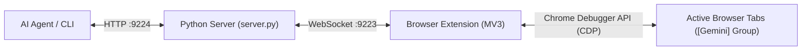
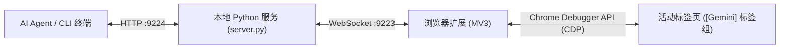

# Antigravity Browser Bridge
not available in Google Web Store, im not gonna pay that $5

[English](#english) · [简体中文](#chinese)

---

<a id="english"></a>

## English

A local browser automation bridge for Microsoft Edge and Google Chrome.

Antigravity Browser Bridge allows AI agents and scripts to control your everyday, logged-in browser via the Chrome DevTools Protocol (CDP). Controlled pages run directly inside your existing browser profile and are automatically organized into a native purple `[Gemini]` tab group.

[](LICENSE)
[](extension/manifest.json)
[](server/server.py)
[](plugin.json)

### Why Browser Bridge?

Traditional browser automation tools (e.g., standard Playwright or Puppeteer) launch clean, isolated headless instances. While suitable for CI, this creates friction for daily workflows:
- **No Stored Sessions**: You lose saved cookies, active logins, bookmarks, and browser extensions.
- **Bot Detection**: Automated fresh browsers frequently trigger Cloudflare challenges and CAPTCHAs.
- **Disconnected Window**: Actions occur in an invisible or separate window away from your active work.

**Antigravity Browser Bridge** operates inside your existing browser:
- **Preserved Sessions**: Interacts directly with sites you are already signed into.
- **Native Tab Grouping**: AI-opened tabs are automatically organized into a labeled `[Gemini]` tab group; the group disbands and closes as soon as all agent tabs are closed, never affecting your existing tabs.
- **Local-Only Communication**: Extension connects via `ws://127.0.0.1:9223`; HTTP API runs on `http://127.0.0.1:9224`. No cloud relay.
- **Self-Healing Daemon**: The CLI automatically boots the background service if it is not already running.

### Architecture



### Quickstart

#### 1. Requirements
- Python 3.10+
- Microsoft Edge or Google Chrome
- Install Python dependencies:
  ```bash
  pip install -r server/requirements.txt
  ```

#### 2. Load the Extension
1. Open your browser extensions page:
   - Microsoft Edge: `edge://extensions/`
   - Google Chrome: `chrome://extensions/`
2. Turn on **Developer mode**.
3. Click **Load unpacked** and select the `extension/` directory of this repo.
4. The extension icon will show `OFF` until the server is running.

#### 3. Start the Server
- **Foreground**:
  ```powershell
  python server/server.py
  ```
- **Silent Background Daemon (Windows)**:
  Double-click `start_silent.vbs` or run `start_server.bat`.

Once the server connects, the extension badge switches to `ON` (green).

### CLI Reference

The CLI utility (`server/cli.py`) lets you inspect and control the browser from terminal scripts or AI agent tool calls:

| Command | Usage | Description |
|---|---|---|
| `status` | `py server/cli.py status` | Checks server health and connected browser instances. |
| `tabs` | `py server/cli.py tabs` | Lists all open tabs across connected browsers. |
| `open` | `py server/cli.py open <url>` | Opens a URL in a new tab inside the `[Gemini]` group. |
| `snapshot` | `py server/cli.py snapshot [tabId]` | Captures an indexed list of interactive DOM elements. |
| `click` | `py server/cli.py click <tabId> <target>` | Clicks an element by index (`"#1"`), selector, or visible text. |
| `type` | `py server/cli.py type <tabId> <selector> <text>` | Enters text into an input or textarea element. |
| `text` | `py server/cli.py text [tabId]` | Extracts plain text content from the current page. |
| `screenshot` | `py server/cli.py screenshot [tabId] -o <path>` | Takes a screenshot and saves it to a file. |
| `eval` | `py server/cli.py eval <tabId> <expression>` | Executes arbitrary JavaScript in the page context. |
| `cdp` | `py server/cli.py cdp <tabId> <method> [params_json]` | Executes a raw Chrome DevTools Protocol command. |
| `group` / `tag` | `py server/cli.py group [tabId]` | Manually adds an existing tab to the `[Gemini]` tab group. |
| `ungroup` | `py server/cli.py ungroup [--tab <tabId>]` | Disbands the `[Gemini]` tab group or ungroups specified tab. |
| `close` | `py server/cli.py close <tabId>` | Closes the specified browser tab. |

### HTTP REST API

The local server exposes HTTP endpoints at `http://127.0.0.1:9224`:

| Method | Endpoint | Payload | Description |
|---|---|---|---|
| `GET` | `/health` | None | Returns server status and connected browser details. |
| `GET` | `/tabs` | None | Lists all tabs across connected browsers. |
| `GET` | `/active_tab` | None | Retrieves the currently active tab ID and URL. |
| `POST` | `/new_tab` | `{"url": "...", "active": true}` | Opens a new tab in the `[Gemini]` tab group. |
| `POST` | `/navigate` | `{"tabId": 123, "url": "..."}` | Navigates an existing tab to a target URL. |
| `POST` | `/snap` | `{"tabId": 123}` | Returns structured interactive elements with assigned IDs. |
| `POST` | `/click` | `{"tabId": 123, "selector": "#btn"}` | Clicks element by indexed reference or CSS selector. |
| `POST` | `/type` | `{"tabId": 123, "selector": "#kw", "text": "...", "clear": true}` | Types text into an element. |
| `POST` | `/content` | `{"tabId": 123}` | Extracts page title, URL, and readable body text. |
| `POST` | `/screenshot`| `{"tabId": 123, "output": "page.png"}` | Captures viewport screenshot (returns base64 or saves to file). |
| `POST` | `/eval` | `{"tabId": 123, "expression": "document.title"}` | Evaluates JavaScript in the page context. |
| `POST` | `/cdp` | `{"tabId": 123, "method": "...", "params": {...}}` | Dispatches raw CDP command. |
| `POST` | `/group` | `{"tabId": 123}` | Adds tab to the `[Gemini]` group. |
| `POST` | `/ungroup` | `{"tabId": 123}` (optional) | Disbands the `[Gemini]` group or ungroups tab. |
| `POST` | `/close_tab`| `{"tabId": 123}` | Closes a tab. |

### Antigravity Plugin Integration

To use this project as an Antigravity plugin:
- Copy or link this repository to `~/.gemini/config/plugins/browser-bridge` (global) or `.agents/plugins/browser-bridge` (workspace).
- The embedded skill definition (`skills/browser-bridge/SKILL.md`) is automatically recognized by Antigravity agents.

### Privacy & Security

- **Localhost Only**: Both WebSocket (`9223`) and HTTP (`9224`) servers bind exclusively to `127.0.0.1`.
- **Zero Cloud Relay**: Page contents, DOM trees, and screenshots never leave your local machine.
- **Visual Indication**: Chromium displays its standard debugger banner whenever an automation session attaches to a tab.

### License

Apache License 2.0.

---

<a id="chinese"></a>

## 简体中文

专为 Microsoft Edge 与 Google Chrome 设计的本地浏览器控制桥接工具。

Antigravity Browser Bridge 允许 AI Agent 和自动化脚本通过 Chrome DevTools Protocol (CDP) 直接控制你日常使用的真实浏览器。受控标签页直接复用当前浏览器的登录态与配置，并自动整理到原生的紫色 `[Gemini]` 标签页组中。

[](LICENSE)
[](extension/manifest.json)
[](server/server.py)
[](plugin.json)

### 为什么选择 Browser Bridge？

传统的浏览器自动化工具（如独立的 Playwright / Puppeteer）通常启动全新、隔离的无头浏览器。这在自动化测试时很有用，但在日常个人开发与辅助场景下存在明显短板：
- **丢失用户会话**：无法复用日常浏览器的 Cookie、登录态、收藏夹与扩展。
- **易被反爬拦截**：无状态的新浏览器极易触发 Cloudflare 验证码与人机检测。
- **与工作流脱节**：操作在隐蔽或独立的窗口中进行，无法直观查看和介入。

**Antigravity Browser Bridge** 采用直通真实浏览器的方案：
- **复用真实登录态**：直接在已登录账号的日常浏览器中操作，无缝访问内网系统与需要登录的网站。
- **原生标签页组收纳**：仅由 AI 新建的标签页会自动归入紫色的 `[Gemini]` 标签页组；当 AI 开启的标签页全部关闭时，标签组自动解散退出，绝不干扰用户原有的日常标签页。
- **纯本地通信**：扩展通过 `ws://127.0.0.1:9223` 连接本地 Python 服务，Agent / CLI 通过 `http://127.0.0.1:9224` 发送指令，无任何云端中继。
- **后台服务自愈**：CLI 工具在检测到服务离线时会自动在后台拉起，无需人工每次手动常驻。

### 架构设计



### 快速开始

#### 1. 环境准备
- Python 3.10 及以上
- Microsoft Edge 或 Google Chrome
- 安装依赖：
  ```bash
  pip install -r server/requirements.txt
  ```

#### 2. 安装浏览器扩展
1. 打开浏览器扩展管理页面：
   - Microsoft Edge：`edge://extensions/`
   - Google Chrome：`chrome://extensions/`
2. 开启 **开发者模式**（Edge 在左下角，Chrome 在右上角）。
3. 点击 **加载解压缩的扩展**，选择本项目中的 `extension/` 目录。
4. 未启动本地服务前，扩展图标角标会显示 `OFF`。

#### 3. 启动本地服务
- **前台控制台运行**：
  ```powershell
  python server/server.py
  ```
- **后台静默运行（Windows）**：
  双击 `start_silent.vbs` 或运行 `start_server.bat`。

服务连接成功后，浏览器扩展角标会自动切换为绿色 `ON`。

### CLI 命令行速查

通过 `server/cli.py` 可以在终端或 Agent 脚本中直接控制浏览器：

| 命令 | 示例 | 功能说明 |
|---|---|---|
| `status` | `py server/cli.py status` | 查看服务健康状态与当前已连接的浏览器实例。 |
| `tabs` | `py server/cli.py tabs` | 列出所有已连接浏览器中的打开标签页。 |
| `open` | `py server/cli.py open <url>` | 在 `[Gemini]` 标签组中打开新网页。 |
| `snapshot` | `py server/cli.py snapshot [tabId]` | 提取页面中带编号的可交互元素快照。 |
| `click` | `py server/cli.py click <tabId> <target>` | 通过编号（如 `"#1"`）、选择器或可见文本点击元素。 |
| `type` | `py server/cli.py type <tabId> <selector> <text>` | 在指定的输入框中键入文本。 |
| `text` | `py server/cli.py text [tabId]` | 提取当前页面的纯文本正文内容。 |
| `screenshot` | `py server/cli.py screenshot [tabId] -o <path>` | 截取网页屏幕截图并保存至指定路径。 |
| `eval` | `py server/cli.py eval <tabId> <expression>` | 在网页上下文执行 JavaScript 表达式。 |
| `cdp` | `py server/cli.py cdp <tabId> <method> [params_json]` | 发送原生 Chrome DevTools Protocol (CDP) 指令。 |
| `group` / `tag` | `py server/cli.py group [tabId]` | 手动将已有标签页归入 `[Gemini]` 标签组。 |
| `ungroup` | `py server/cli.py ungroup [--tab <tabId>]` | 解散 `[Gemini]` 标签组或移出指定标签页。 |
| `close` | `py server/cli.py close <tabId>` | 关闭指定的浏览器标签页。 |

### HTTP REST API 接口清单

本地服务在 `http://127.0.0.1:9224` 提供标准化 HTTP API：

| 方法 | 路径 | 请求体 (JSON) | 功能说明 |
|---|---|---|---|
| `GET` | `/health` | 无 | 获取服务运行状态及已连接浏览器信息。 |
| `GET` | `/tabs` | 无 | 获取当前所有标签页列表。 |
| `GET` | `/active_tab` | 无 | 获取当前处于激活状态的标签页信息。 |
| `POST` | `/new_tab` | `{"url": "...", "active": true}` | 在 `[Gemini]` 组中创建新标签页。 |
| `POST` | `/navigate` | `{"tabId": 123, "url": "..."}` | 让指定标签页导航到目标网址。 |
| `POST` | `/snap` | `{"tabId": 123}` | 提取页面结构快照与带标号交互元素。 |
| `POST` | `/click` | `{"tabId": 123, "selector": "#btn"}` | 模拟点击元素（支持编号或 CSS 选择器）。 |
| `POST` | `/type` | `{"tabId": 123, "selector": "#kw", "text": "...", "clear": true}` | 模拟输入文本内容。 |
| `POST` | `/content` | `{"tabId": 123}` | 提取网页标题、网址与主体文本。 |
| `POST` | `/screenshot`| `{"tabId": 123, "output": "page.png"}` | 截取网页截图（返回 base64 或直接写入文件）。 |
| `POST` | `/eval` | `{"tabId": 123, "expression": "document.title"}` | 在页面中执行 JavaScript 脚本。 |
| `POST` | `/cdp` | `{"tabId": 123, "method": "...", "params": {...}}` | 执行原生 CDP 指令。 |
| `POST` | `/group` | `{"tabId": 123}` | 将标签页加入 `[Gemini]` 标签组。 |
| `POST` | `/ungroup` | `{"tabId": 123}` (可选) | 解散 `[Gemini]` 标签组或移出标签页。 |
| `POST` | `/close_tab`| `{"tabId": 123}` | 关闭标签页。 |

### Antigravity 插件集成

若需在 Antigravity 中全局使用本能力：
- 将本仓库拷贝或链接至 `~/.gemini/config/plugins/browser-bridge`（全局）或工作区 `.agents/plugins/browser-bridge`。
- 本仓库已内置标准 Skill 定义（`skills/browser-bridge/SKILL.md`），安装后 Agent 会自动调用该能力进行网页浏览与自动化交互。

### 安全与隐私

- **仅限本地回环**：WebSocket (`9223`) 与 HTTP (`9224`) 服务严格绑定到 `127.0.0.1`，不监听外部网络。
- **无云端中继**：网页 DOM、快照与截图全程在本地机器流转，绝不上传任何云端服务器。
- **原生安全提示**：Chromium 会在调试接口被附加时展示原生黄色提示条，确保操作完全透明可知。

### 开源协议

本项目采用 Apache License 2.0 许可证。
