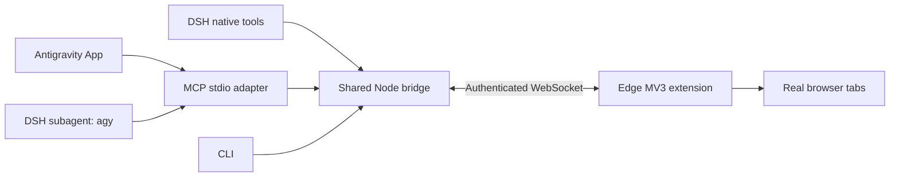

# Browser Bridge

让 **DeepSeek Harness Desktop v0.2.1-rc.3、Antigravity App 和 `agy` 子代理**使用同一套 Microsoft Edge 浏览器操控能力。基于原 Antigravity Browser Bridge 重构；保留 Apache-2.0 许可和原项目来源，不包含 IDE 适配。

**v2.0.0 发布状态：已实现并打包，尚未运行自动化测试或双宿主端到端验收。**

## 安装

下载 [v2.0.0 发布包](https://github.com/AshenJyy/antigravity-browser-bridge/releases/tag/v2.0.0)，完整步骤见 [中文安装说明](docs/INSTALL.zh-CN.md)。

- DSH：下载 [dsh-browser-bridge-2.0.0.tgz](https://github.com/AshenJyy/antigravity-browser-bridge/releases/download/v2.0.0/dsh-browser-bridge-2.0.0.tgz)，在插件管理中添加本地包，使用官方 `dsh.bundle.patch` / Cordis 插件格式。
- Antigravity App / agy：下载并解压 [browser-bridge-antigravity-2.0.0.zip](https://github.com/AshenJyy/antigravity-browser-bridge/releases/download/v2.0.0/browser-bridge-antigravity-2.0.0.zip)，运行 `scripts/Install-Antigravity.ps1`。脚本先查看 agy 的插件注册信息；若已发现同一全局目录，直接启用，否则执行安装。DSH 原生工具不会自动传给外部 agy 子进程。
- Edge：在 `edge://extensions` 加载 `extension/`，运行 `scripts/BrowserBridge.ps1 pair`，在扩展弹窗填写本地配对 token。

发布 ZIP 自带打包后的 JavaScript 运行文件，无需额外安装 Python 或 npm 依赖。需要 Node.js 22+；Windows 脚本可使用 DSH 自带 Node 运行时。源码开发使用 Node.js 与 npm/pnpm。

## 能力

27 个统一 `browser_*` 工具覆盖标签页管理、正文与结构化快照、指定标签截图、DOM/坐标点击、悬停、输入、按键、滚动、下拉选择、导航、等待、上传、下载与对话框。DSH 通过官方多模态附件适配返回截图；Antigravity 通过标准 MCP image block 返回。

- 复用真实 Edge 的登录状态，以扩展持久实例 ID 区分多个配置。
- 标签句柄包含实例身份，操作前须新建或明确接管；无活动页隐式回退。
- DSH 按 Agent/Session、Antigravity 按 MCP 进程隔离；共享 MCP 进程的聊天不自动获得独立身份。
- 按任务显示标签组，关闭/释放均有明确动作；释放不会关闭用户页面。
- 本地 token 配对、HTTP/WS 来源检查、串行执行、断线重连及不重放副作用的错误处理。

浏览器内部页、原生系统窗口、封闭组件等受浏览器接口限制。截图需要宿主模型支持图像。工具结果会交给宿主模型，不能宣称“网页内容绝不离开本机”。详细范围及未验收项见安装说明。

## 架构



默认监听 `127.0.0.1:9224`，按需后台启动。状态与 token 默认放在 `%LOCALAPPDATA%\BrowserBridge`；`BROWSER_BRIDGE_PORT`、`BROWSER_BRIDGE_DATA_DIR` 可配置。双方必须使用同样的设置。

协议见 [PROTOCOL.md](docs/PROTOCOL.md)，Agent 操作说明见 [SKILL.md](skills/browser-bridge/SKILL.md)。v1 HTTP 路由和数字标签 ID 已退役；旧 Python 入口只转发至 Node，新 CLI 参数见 `--help`。

## 构建

```powershell
pnpm install --frozen-lockfile
node scripts/build.mjs
py scripts/package_release.py --output work/releases
```

构建生成独立 runtime；打包生成 npm-compatible DSH `.tgz` 和 Antigravity `.zip`，不安装、不启动宿主、不调用模型。仓库包含开发测试文件，但 v2.0.0 发布流程未执行这些测试。

## English

Browser Bridge gives DSH Desktop 0.2.1-rc.3, Antigravity App, and the `agy` CLI used by DSH subagents a shared interface to the user's real Edge profile. It ships a native DSH bundle, a stdio MCP adapter, and an authenticated MV3 extension. Select or claim explicit tab handles; no command silently acts on the active page. Screenshots are actual image tool results. Version 2.0.0 is implemented and packaged, but automated tests and end-to-end host acceptance have not been run. Download the packages from the [v2.0.0 release](https://github.com/AshenJyy/antigravity-browser-bridge/releases/tag/v2.0.0).

Original project: [AshenJyy/antigravity-browser-bridge](https://github.com/AshenJyy/antigravity-browser-bridge). License: [Apache-2.0](LICENSE).
