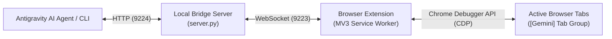

# Antigravity Browser Bridge 🌐✨

> **Direct, seamless browser automation for Antigravity AI assistant.** Control your real Microsoft Edge or Google Chrome browser via Chrome DevTools Protocol (CDP) with native tab grouping, zero credential loss, and a self-healing background daemon.

[](LICENSE)
[](extension/manifest.json)
[](server/server.py)
[](plugin.json)

---

## 💡 Why Browser Bridge?

Traditional AI agent browser automation typically spawns independent, headless Puppeteer or Playwright instances. This causes:
- ❌ **Lost user state**: No saved cookies, accounts, logins, or extensions.
- ❌ **Bot detection**: Automated browsers easily trigger Cloudflare / Captcha barriers.
- ❌ **Disconnected UX**: Actions happen in an invisible or separate window, away from your primary workflow.

**Antigravity Browser Bridge** takes a different approach:
- ✅ **Your Real Browser**: Operates directly inside your everyday Microsoft Edge or Google Chrome browser.
- ✅ **Preserved Logins & Cookies**: Seamlessly search, browse, and interact with sites you are already logged into.
- ✅ **Native Tab Organization**: AI-controlled tabs automatically group into a distinct, native purple `[Gemini]` tab group with the official vector Gemini logo.
- ✅ **Full CDP Power**: Full access to Chrome DevTools Protocol (`Page`, `Runtime`, `DOM`, `Input`, `Network`, `Storage`).
- ✅ **Self-Healing Daemon**: Built-in health checks automatically launch or revive the server if it ever stops.
- ✅ **100% Local & Private**: All communications stay strictly within your local machine (`127.0.0.1`).

---

## 🏗️ Architecture



---

## 🚀 Quick Start

### 1. Prerequisites
- Python 3.10 or later
- Microsoft Edge or Google Chrome
- Install Python dependencies:
  ```bash
  pip install -r server/requirements.txt
  ```

### 2. Load the Extension into Edge or Chrome
1. Open your browser and navigate to the Extensions management page:
   - **Microsoft Edge**: `edge://extensions/`
   - **Google Chrome**: `chrome://extensions/`
2. Enable **Developer mode** (toggle in the bottom-left of Edge or top-right of Chrome).
3. Click **Load unpacked** (加载解压缩的扩展).
4. Select the `extension/` folder inside this repository.
5. The extension badge will display `OFF` until the local server is started.

### 3. Start the Bridge Server
Run the startup script:
- **Windows**: Double-click `start_server.bat` or run:
  ```powershell
  python server/server.py
  ```
- **Silent Background Daemon (Windows)**:
  Double-click `start_silent.vbs` or run `开机自动启动服务.bat` to automatically register it for silent startup on boot.

Once started, the browser extension icon will turn green (`ON`), indicating that the bridge is live and ready!

---

## 💻 CLI Usage

The repository includes a handy CLI tool `server/cli.py` to inspect and interact with the browser directly from the terminal:

```bash
# Check bridge and extension connection status
py server/cli.py status

# List all open browser tabs
py server/cli.py tabs

# Open a new webpage (automatically grouped into [Gemini])
py server/cli.py open "https://github.com"

# Capture a structured snapshot of interactive buttons and inputs
py server/cli.py snapshot <tabId>

# Click an element by index number or text
py server/cli.py click <tabId> "#1"
py server/cli.py click <tabId> "Sign in"

# Type into an input field
py server/cli.py type <tabId> "#search" "machine learning"

# Take a screenshot
py server/cli.py screenshot <tabId> -o "screenshot.png"

# Execute arbitrary JavaScript in the page context
py server/cli.py eval <tabId> "document.title"

# Execute a raw Chrome DevTools Protocol (CDP) command
py server/cli.py cdp <tabId> Page.captureScreenshot '{"format":"png"}'
```

---

## 🔌 Using as an Antigravity Plugin

This repository is formatted as a standard Antigravity Plugin bundle:

```text
antigravity-browser-bridge/
├── plugin.json              # Antigravity Plugin manifest
├── LICENSE                  # Apache 2.0 license
├── README.md                # Documentation
├── extension/               # Chromium MV3 extension
├── server/                  # Python WebSocket & HTTP daemon
├── skills/                  # Embedded AI skill definitions
│   └── browser-bridge/
│       └── SKILL.md
└── scripts/                 # Platform launcher scripts
```

### Installation into Antigravity
To make this plugin available across all your Antigravity sessions:
- Copy or clone this folder into `~/.gemini/config/plugins/browser-bridge`
- Or include it in your project's `.agents/plugins/browser-bridge`

Once installed, the AI assistant will automatically recognize the `browser-bridge` skill whenever you ask it to view pages, click buttons, extract content, or automate browser workflows!

---

## 🔒 Privacy & Security

- **Strict Local Loopback**: Both HTTP (`9224`) and WebSocket (`9223`) servers bind exclusively to `127.0.0.1`. No external network exposure or telemetry exists.
- **Zero Cloud Relay**: Page DOMs, screenshots, and interactions never leave your computer.
- **Visual Awareness**: Whenever an AI session attaches to a tab, Chromium displays a native debugger banner, and tabs are neatly isolated within the labeled `[Gemini]` tab group.

---

## 📝 Changelog

See [CHANGELOG.md](CHANGELOG.md) for full release notes and version history.

---

## 📄 License

This project is open-source software licensed under the [Apache License 2.0](LICENSE).
