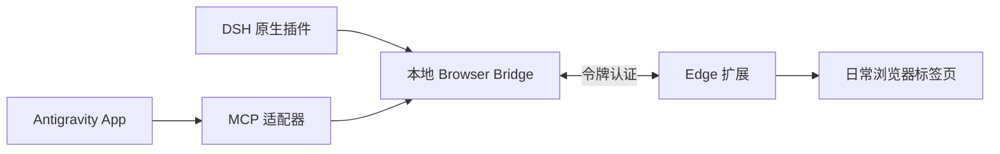

# Browser Bridge

让 **DeepSeek Harness Desktop 和 Antigravity App** 直接操作日常使用、已经登录的 **Microsoft Edge**。

DSH 通过原生插件调用浏览器工具，Antigravity App 通过 MCP 调用；两端共用本地桥接服务和 Edge 扩展，可读取页面、截图、点击、输入和管理标签页。

**中文** · [English](README.en.md) · [下载 v2.0.2](https://github.com/AshenJyy/browser-bridge/releases/tag/v2.0.2) · [安装说明](docs/INSTALL.zh-CN.md) · [文档目录](docs/README.md) · [更新记录](CHANGELOG.md)

## 下载与安装

| 使用入口 | 下载 | 安装方式 |
| --- | --- | --- |
| DSH Desktop | [dsh-browser-bridge-2.0.2.tgz](https://github.com/AshenJyy/browser-bridge/releases/download/v2.0.2/dsh-browser-bridge-2.0.2.tgz) | 在 DSH 插件管理中添加本地包，再重启相关工作配置或服务 |
| Antigravity App | [browser-bridge-antigravity-2.0.2.zip](https://github.com/AshenJyy/browser-bridge/releases/download/v2.0.2/browser-bridge-antigravity-2.0.2.zip) | 解压后运行 `scripts/Install-Antigravity.ps1`，再重启 App |
| Microsoft Edge | 上述 ZIP 内的 `browser-bridge/extension/`，或源码中的 [`extension/`](extension/) | 在 `edge://extensions` 开启开发者模式，加载解压缩的扩展 |

仅使用 DSH 时，也可以从 ZIP 中提取 Edge 扩展，无需安装 Antigravity App 插件。

完成插件和扩展安装后，在解压后的 `browser-bridge` 目录中执行：

```powershell
powershell -NoProfile -ExecutionPolicy Bypass -File .\scripts\BrowserBridge.ps1 pair
```

将输出的令牌和端口填入 Edge 扩展弹窗。正常只需配对一次；后续调用会按需启动桥接服务。完整步骤、自定义配置和配对故障处理见 [安装说明](docs/INSTALL.zh-CN.md)。

## 版本要求

| 组件 | 要求 |
| --- | --- |
| DSH Desktop | `>=0.2.1-rc.3 <=0.2.1`，允许 rc.3 及后续 `0.2.1-rc.*` 和 `0.2.1` 正式版，无需逐个登记 |
| Node.js | 22+；Windows 脚本优先使用 DSH 自带运行时 |
| Microsoft Edge | 125+，使用已加载 Browser Bridge 扩展的浏览器配置 |
| Antigravity | 支持插件的 Antigravity App |

发布 ZIP 自带 JavaScript 运行文件，使用时无需安装 Python 或 npm 依赖。DSH 直接注册原生工具，无需 agy 或外部子代理。

**发布状态：** v2.0.2 已构建和打包，未运行自动化测试、逐版本验证或双宿主端到端验收。声明的版本范围不等于每个版本都已经验证。

## 可以做什么

- **读取页面：** 正文、结构化快照、真实标签页截图。
- **操作网页：** 点击、悬停、输入、按键、滚动、下拉选择、导航与等待。
- **处理文件与对话框：** 文件上传、工具发起的下载、JavaScript 对话框。
- **管理标签页：** 列举、新建、明确接管、分组、释放与关闭。

27 个统一 `browser_*` 工具复用现有 Edge 的登录状态。截图以图像工具结果返回，所选模型需要支持图像。每次操作都指定标签句柄，不会默认操作当前活动页面。

DSH 按 Agent/Session 分配标签归属；Antigravity 按 MCP 进程分配。共享同一 MCP 进程的聊天不自动获得独立身份。浏览器内部页和原生系统窗口不在操作范围内，其他限制见 [范围与限制](docs/INSTALL.zh-CN.md#范围与限制)。

## 如何连接



默认监听 `127.0.0.1:9224`。Windows 状态和令牌保存在 `%USERPROFILE%\.browser-bridge`；端口与状态目录可配置。两端使用相同设置即可共享桥接服务。页面内容和截图会交给所用宿主与模型处理。

## 文档与源码

| 入口 | 内容 |
| --- | --- |
| [文档目录](docs/README.md) | 安装、开发、协议和旧版入口的导航 |
| [开发说明](docs/DEVELOPMENT.md) | 源码目录、构建方式与发布包结构 |
| [协议说明](docs/PROTOCOL.md) | HTTP、WebSocket 和会话约定 |
| [旧版启动入口](docs/LEGACY.md) | Python 转发器、手动启动和开机自启脚本的用途 |
| [更新记录](CHANGELOG.md) | 各版本的变更 |
| [Issues](https://github.com/AshenJyy/browser-bridge/issues) | 问题反馈与功能建议 |

本项目由原 Antigravity Browser Bridge 重构，采用 [Apache-2.0](LICENSE) 许可，是面向 DSH 与 Antigravity App 的社区插件。
